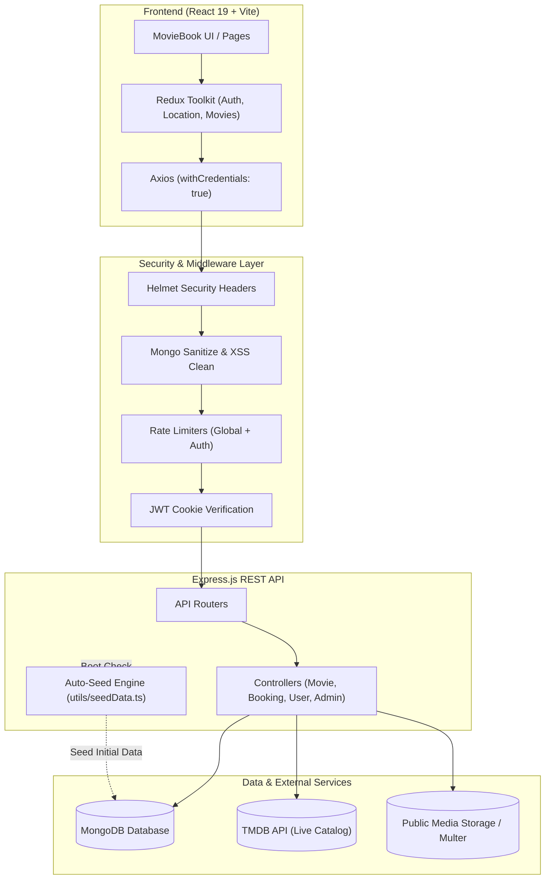

# 🎬 Movie Reservation System

[](https://www.typescriptlang.org/)
[](https://nodejs.org/)
[](https://expressjs.com/)
[](https://react.dev/)
[](https://vitejs.dev/)
[](https://www.mongodb.com/)
[](https://www.docker.com/)
[](https://redux-toolkit.js.org/)
[](https://opensource.org/licenses/ISC)

A full-stack, enterprise-grade movie ticketing and entertainment reservation platform named **MovieBook**. Built with **React 19**, **Vite**, **Express**, and **MongoDB**, it features interactive tiered cinema seating layouts, real-time seat locking, food & beverage add-on checkout, digital QR-code ticket issuance, multi-city filtering, TMDB live API catalog synchronization, and a dedicated admin administration panel.

---

## 📑 Table of Contents

- [Key Features](#-key-features)
- [Architecture & Tech Stack](#-architecture--tech-stack)
- [System Architecture Flow](#-system-architecture-flow)
- [Project Directory Structure](#-project-directory-structure)
- [Prerequisites](#-prerequisites)
- [Installation & Quick Start](#-installation--quick-start)
- [Environment Configuration](#-environment-configuration)
- [Demo Credentials](#-demo-credentials)
- [API Reference](#-api-reference)
- [Booking Lifecycle & Seat Pricing](#-booking-lifecycle--seat-pricing)
- [Automated AI Code Review Agent](#-automated-ai-code-review-agent)
- [Available Scripts](#-available-scripts)
- [License](#-license)

---

## ✨ Key Features

### 🎟️ User & Customer Experience
- **Interactive Multi-Tier Seat Matrix**: Visual seat map featuring **Classic**, **Prime**, and **VIP / Recliner** tiers with dynamic pricing and real-time occupied seat checking to prevent double-booking.
- **Dynamic Entertainment Catalog**: Supports Movies, Stream Premieres, Live Concerts/Events, Theatre Plays, Sports, and Outdoor Activities.
- **Location & City Switcher**: Filter movies and showtimes across major metropolitan regions (Delhi-NCR, Mumbai, Bengaluru, Hyderabad, Chandigarh, Pune, Chennai, and more).
- **Comprehensive Movie Details**: Synopses, runtime, certification badges (U/A, A, U), multi-language and format badges (IMAX, 4DX, 2D, 3D), trailers, cast and crew profiles.
- **Community Ratings & Reviews**: 10-point rating scale, verified audience reviews, vote counters, and review submission.
- **F&B (Food & Beverages) Cart**: Add cinema snacks (Popcorn combos, Pepsi, Nachos) directly into the ticket checkout workflow.
- **Transparent Order Summary**: Itemized billing with base ticket prices, per-ticket convenience fees (₹30), and 18% GST calculation.
- **Digital QR Code Tickets**: Instantly generated QR ticket upon booking completion, displayable on-screen and stored under user booking history.
- **Cancellation & Refunds**: In-app booking cancellation allowed up to 20 minutes before showtime with automated refund calculations.
- **User Profile & Booking History**: View current and past tickets, booking status (`CONFIRMED`, `CANCELLED`), and update profile details.

### 🛡️ Admin Management Portal
- **Protected Admin Dashboard**: Separate admin authentication with dedicated route guards (`/admin/*`).
- **Movie Catalog Management**: Add and publish new titles with posters, backdrops, duration, genre, certifications, cast, and crew.
- **Showtime Scheduler**: Create and assign showtimes across theatres, screen numbers, formats, pricing, and operational date windows.

### 🔒 Enterprise Security & Reliability
- **HTTP Security Headers**: Powered by `helmet` to mitigate clickjacking and MIME sniffing.
- **Injection Protection**: Sanitization against NoSQL query injection (`express-mongo-sanitize`) and custom recursive XSS / prototype-pollution sanitization.
- **HTTP Parameter Pollution**: Protected using `hpp`.
- **Rate Limiting**: Tiered IP rate limiting with stricter limits on authentication routes (`express-rate-limit`).
- **Secure Authentication**: Password hashing with `bcrypt` (10 rounds) and HTTP-only, SameSite JWT authentication cookies.
- **Stripe Payments Integration**: Server-priced `PaymentIntents`, `@stripe/react-stripe-js` Elements checkout, atomic seat-conflict auto-refunds, cancellation refunds, and raw-body signed webhooks.
- **Automated Database Seeding**: Preloaded with a realistic late-2026 entertainment catalog, demo accounts, showtimes, and reviews on first boot.

---

## 🛠️ Architecture & Tech Stack

### Frontend
- **Language**: [TypeScript](https://www.typescriptlang.org/) (`strict: true`)
- **Framework**: [React 19](https://react.dev/) + [Vite](https://vitejs.dev/)
- **Routing**: [React Router DOM v7](https://reactrouter.com/)
- **State Management**: [Redux Toolkit](https://redux-toolkit.js.org/) + `react-redux` (Typed `useAppDispatch` / `useAppSelector`)
- **Payments**: [Stripe Elements](https://stripe.com/docs/payments/elements) (`@stripe/stripe-js`, `@stripe/react-stripe-js`)
- **HTTP Client**: [Axios](https://axios-http.com/) (configured with credentials for HTTP-only cookies)
- **Icons**: [Lucide React](https://lucide.dev/)
- **QR Code Engine**: [qrcode.react](https://github.com/zpao/qrcode.react)
- **Styling**: Vanilla CSS Modules (`*.module.css`) + Responsive Container Queries & Design Tokens

### Backend
- **Language**: [TypeScript](https://www.typescriptlang.org/) compiled via `tsc` to `dist/` (`tsx` for dev)
- **Runtime**: [Node.js](https://nodejs.org/) (v20+)
- **Web Framework**: [Express.js](https://expressjs.com/) (v4.22)
- **Database**: [MongoDB](https://www.mongodb.com/) via [Mongoose ODM](https://mongoosejs.com/)
- **Payments**: [Stripe Node SDK](https://github.com/stripe/stripe-node)
- **Authentication**: [JSON Web Tokens (JWT)](https://jwt.io/) & [cookie-parser](https://github.com/expressjs/cookie-parser)
- **Password Security**: [bcrypt](https://github.com/kelektiv/node.bcrypt.js)
- **Media Uploads**: [Multer](https://github.com/expressjs/multer) with binary magic-byte validation
- **External Movie Sync**: [The Movie Database (TMDB) API](https://www.themoviedb.org/documentation/api)

---

## 🔄 System Architecture Flow



---

## 📁 Project Directory Structure

```text
Movie-Reservation-System/
├── .env.example             # Template for backend environment variables
├── .env                     # Local environment configuration (git-ignored)
├── tsconfig.json            # Strict backend TypeScript configuration (outputs to dist/)
├── index.ts                 # Express server entry point & middleware pipeline
├── package.json             # Root backend dependencies & scripts
├── types/
│   ├── express.d.ts         # Express Request.user JWT payload augmentation
│   └── modules.d.ts         # Third-party middleware type declarations
├── database/
│   └── db.ts                # MongoDB connection handler via Mongoose
├── controller/
│   ├── adminController.ts   # Admin auth & real-time dashboard analytics
│   ├── movieController.ts   # Movie catalog CRUD & TMDB sync logic
│   ├── movieReservationController.ts # Seat booking, conflict checks & cancellations
│   ├── paymentController.ts # Stripe PaymentIntents, refunds & signed webhooks
│   ├── reviewController.ts  # Audience ratings & reviews handling
│   ├── showTimeController.ts# Showtime scheduling and date queries
│   └── userController.ts    # User authentication, profiles & session cookies
├── models/
│   ├── adminModel.ts        # Admin credentials schema
│   ├── movieModel.ts        # Movie & entertainment title schema
│   ├── movieReservationModel.ts # Booking snapshot, seat tiers & payment schema
│   ├── reviewModel.ts       # User review and rating schema
│   ├── showTimeModel.ts     # Cinema screen, slots & pricing schema
│   └── userModel.ts         # User registration & profile schema
├── routes/
│   ├── adminRoutes.ts       # Admin auth & stats endpoints (/api/admin)
│   ├── movieReservationRoutes.ts # Reservation endpoints (/api/movieReservation)
│   ├── movieRoutes.ts       # Movies endpoints (/api/movie)
│   ├── paymentRoutes.ts     # Stripe config & PaymentIntent endpoints (/api/payments)
│   ├── reviewRoutes.ts      # Reviews endpoints (/api/reviews)
│   ├── showTimeRoutes.ts    # Showtime endpoints (/api/showtimes)
│   └── userRoutes.ts        # User auth & profile endpoints (/api/user)
├── utils/
│   ├── imageUpload.ts       # Multer file upload setup with magic-byte validation
│   ├── pricing.ts           # Authoritative server-side seat, F&B & promo pricing
│   ├── rateLimiter.ts       # Express rate limiter presets
│   ├── seedData.ts          # Comprehensive late-2026 catalog seed script
│   └── tokenVerification.ts # JWT verification and role-guard middlewares
├── tools/
│   ├── code-review-agent.ts # Gemini-powered static code review agent
│   └── .codereviewrc.json   # Code review scanner rules & targets
├── public/                  # Static assets and uploaded images
└── client/                  # Frontend Vite React + TypeScript Single Page Application
    ├── index.html           # HTML5 document template
    ├── package.json         # Frontend dependencies and Vite scripts
    ├── tsconfig.json        # Strict frontend TypeScript configuration
    ├── vite.config.ts       # Vite build & chunking configuration
    └── src/
        ├── App.tsx          # Master application layout and route declarations
        ├── main.tsx         # React DOM root mounting with Redux Provider
        ├── types/
        │   └── index.ts     # Shared TypeScript domain interfaces
        ├── api/
        │   └── axios.ts     # Centralized Axios instance with base URL
        ├── redux/
        │   ├── authSlice.ts     # User authentication state
        │   ├── hooks.ts         # Typed useAppDispatch & useAppSelector hooks
        │   ├── locationSlice.ts # Active city and geography state
        │   ├── movieSlice.ts    # Active movie query and filter state
        │   └── store.ts         # Redux store configuration
        ├── pages/
        │   ├── Home.tsx         # Hero banner, category carousels & city catalog
        │   ├── MovieDetails.tsx # Movie overview, trailer, cast, and reviews
        │   ├── BuyTickets.tsx   # Date bar, cinema theater listing & showtimes
        │   ├── Booking.tsx      # Interactive seat matrix, F&B snacks & Stripe checkout
        │   ├── MyBookings.tsx   # Booking history, QR ticket display & cancel
        │   ├── Profile.tsx      # User profile view and update
        │   ├── SearchResults.tsx# Real-time search query listing
        │   ├── Login.tsx / Register.tsx # Authentication screens
        │   └── admin/
        │       ├── AdminLogin.tsx      # Admin sign-in portal
        │       ├── AdminDashboard.tsx  # Admin overview & management
        │       ├── AddMovie.tsx        # Admin movie creation & editing form
        │       └── AddShowtime.tsx     # Admin showtime scheduling form
        ├── components/      # Navbar, SubNavbar, StripePaymentForm, ConfirmDialog, etc.
        └── styles/          # Modular CSS and responsive design tokens
```

---

## 📦 Prerequisites

Before running the application, make sure you have the following installed:

- **Node.js**: `v18.0.0` or higher ([Download Node.js](https://nodejs.org/))
- **npm**: `v9.0.0` or higher
- **MongoDB**: Local MongoDB instance running on `localhost:27017` or a [MongoDB Atlas](https://www.mongodb.com/cloud/atlas) cloud URI.

---

## 🚀 Installation & Quick Start

### 1. Clone the Repository
```bash
git clone https://github.com/ankit2807/Movie-Reservation-System.git
cd Movie-Reservation-System
```

### 2. Backend Setup
1. Install backend dependencies:
   ```bash
   npm install
   ```
2. Configure your environment variables:
   ```bash
   cp .env.example .env
   ```
3. Update `.env` with your settings (see [Environment Configuration](#-environment-configuration)).
4. Start the backend server:
   ```bash
   npm start
   ```
   > **Note**: On initial startup, the server automatically connects to MongoDB, detects if the database is empty or outdated, and seeds the latest catalog with titles, demo users, showtimes, and reviews!

### 3. Frontend Setup
1. In a new terminal window, navigate to the `client` directory:
   ```bash
   cd client
   ```
2. Install client dependencies:
   ```bash
   npm install
   ```
3. Start the Vite development server:
   ```bash
   npm run dev
   ```
4. Open your browser and navigate to:
   ```text
   http://localhost:5173
   ```

---

## ⚙️ Environment Configuration

Create a `.env` file in the root directory. You can copy the provided template:

```bash
cp .env.example .env
```

| Variable | Description | Required | Default / Example |
| :--- | :--- | :---: | :--- |
| `PORT` | Port for the Express backend server | No | `3000` |
| `NODE_ENV` | Application environment mode (`development` / `production`) | No | `development` |
| `MONGO_URI` | MongoDB connection connection string | **Yes** | `mongodb://localhost:27017/movie-reservation-system` |
| `JWT_SECRET` | Secret key used to sign and verify JWT authentication tokens | **Yes** | `your_jwt_secret_key_here` |
| `FRONTEND_URL`| Allowed frontend origin for CORS policies | No | `http://localhost:5173` |
| `STRIPE_SECRET_KEY`| Stripe secret API key (`sk_test_...` / `sk_live_...`) | Optional* | `sk_test_...` |
| `STRIPE_PUBLISHABLE_KEY`| Stripe publishable key (`pk_test_...` / `pk_live_...`) | Optional* | `pk_test_...` |
| `STRIPE_WEBHOOK_SECRET`| Stripe webhook signing secret (`whsec_...`) for `/api/payments/webhook` | Optional* | `whsec_...` |
| `TMDB_API_KEY`| The Movie Database API key for dynamic movie lookups | No | `your_tmdb_api_key_here` |

> \*When `STRIPE_SECRET_KEY` and `STRIPE_PUBLISHABLE_KEY` are set, Checkout automatically renders **Stripe Elements (`<PaymentElement />`)** with server-priced `PaymentIntents`, automatic refunds on seat conflicts or ticket cancellations, and raw-body signed webhook updates. Without Stripe keys, Checkout falls back to Demo Checkout Mode for local testing.
| `GEMINI_API_KEY`| Google Gemini API key (for the AI Code Review tool) | No | `your_gemini_api_key_here` |

---

## 🔑 Demo Credentials

When the application auto-seeds, demo user accounts are pre-created with hashed passwords for instant testing:

### Test User Accounts
| Name | Email | Password | Role |
| :--- | :--- | :--- | :--- |
| **Aditi Rao** | `aditi@example.com` | `demoUser2026!` | User |
| **Rahul Verma** | `rahul@example.com` | `demoUser2026!` | User |
| **Sneha Gupta** | `sneha@example.com` | `demoUser2026!` | User |
| **Vikram Singh** | `vikram@example.com` | `demoUser2026!` | User |
| **Priya Sharma** | `priya@example.com` | `demoUser2026!` | User |

### Admin Account (Pre-seeded Bootstrap Admin)
| Name | Email | Password | Portal |
| :--- | :--- | :--- | :--- |
| **MovieBook Admin** | `admin@moviebook.com` | `adminBook2026!` | `/admin/login` → `/admin/dashboard` |

> Override `DEMO_USER_PASSWORD`, `ADMIN_EMAIL`, and `ADMIN_PASSWORD` in `.env` before running `npm run seed` in production.

---

## 🐳 Production Build & Cloud Deployment

### Option 1: Single-Origin Node.js Production Server
Build the Vite frontend into `client/dist` and serve both the SPA and `/api` from a single Express instance:
```bash
npm install
npm run build
NODE_ENV=production npm start
```
The production server serves static hashed assets with immutable caching, exposes `/health` (liveness + MongoDB readiness), and handles graceful `SIGTERM`/`SIGINT` shutdown.

### Option 2: Docker & Docker Compose (Full Stack + MongoDB 7)
```bash
docker compose up --build -d
```
- **App + API**: `http://localhost:3000`
- **Health Check**: `http://localhost:3000/health`

### Option 3: Render / Cloud PaaS
- Connect the repository to Render using the included `render.yaml` Blueprint (or deploy the multi-stage `Dockerfile` to Railway, Fly.io, AWS ECS, or Google Cloud Run).
- Set `MONGO_URI` (e.g., MongoDB Atlas) and `JWT_SECRET` in your cloud environment variables.
- If hosting the frontend on a separate domain (e.g., Vercel/Netlify), set `VITE_API_URL=https://your-api-domain.com/api`, `FRONTEND_URL=https://your-frontend-domain.com`, and `CROSS_ORIGIN_AUTH=true`.

---

## 📡 API Reference

All backend API routes are prefixed with `/api`.

### 1. User & Authentication (`/api/user`)
| Method | Endpoint | Access | Description |
| :--- | :--- | :---: | :--- |
| `POST` | `/api/user/register` | Public | Register a new user account |
| `POST` | `/api/user/login` | Public (Rate-limited) | Authenticate user & set HTTP-only JWT cookie |
| `POST` | `/api/user/logout` | Public (Idempotent) | Invalidate and clear auth cookie |
| `GET` | `/api/user/session` | Public | Restore customer/admin session from HTTP-only JWT cookie |
| `GET` | `/api/user/me` | Authenticated | Fetch authoritative profile for logged-in user or admin |
| `PUT` | `/api/user/profile` | Authenticated | Update user name, phone, or password |

### 2. Admin Portal (`/api/admin`)
| Method | Endpoint | Access | Description |
| :--- | :--- | :---: | :--- |
| `POST` | `/api/admin/register` | Admin | Register a new administrator account |
| `POST` | `/api/admin/login` | Public (Rate-limited) | Authenticate administrator & set admin JWT cookie |
| `GET` | `/api/admin/stats` | Admin | Fetch gross revenue, bookings, catalog counts & recent orders |

### 3. Movies Catalog (`/api/movie`)
| Method | Endpoint | Access | Description |
| :--- | :--- | :---: | :--- |
| `GET` | `/api/movie` | Public | Get all entertainment titles (supports filtering by type, city, language) |
| `GET` | `/api/movie/search?query=:q` | Public | Search titles by keyword or genre |
| `GET` | `/api/movie/find/:id` | Public | Fetch complete movie details by MongoDB ID or TMDB ID |
| `POST` | `/api/movie` | Admin | Create and publish a new title |
| `PATCH`| `/api/movie/:id` | Admin | Update movie information |
| `DELETE`| `/api/movie/:id` | Admin | Delete a movie from the catalog |

### 4. Showtimes & Theatres (`/api/showtimes`)
| Method | Endpoint | Access | Description |
| :--- | :--- | :---: | :--- |
| `GET` | `/api/showtimes` | Public | List showtimes (filterable by `movieId`, `date`, `theatre`) |
| `GET` | `/api/showtimes/find/:id` | Public | Get showtime details by ID |
| `POST` | `/api/showtimes` | Admin | Schedule a new showtime slot |
| `PUT` | `/api/showtimes/:id` | Admin | Modify an existing showtime |
| `DELETE`| `/api/showtimes/:id` | Admin | Cancel and remove a showtime |

### 5. Reservations & Bookings (`/api/movieReservation`)
| Method | Endpoint | Access | Description |
| :--- | :--- | :---: | :--- |
| `POST` | `/api/movieReservation` | Authenticated | Book selected seats, add F&B, compute fees & issue ticket |
| `GET` | `/api/movieReservation` | Authenticated | Retrieve all bookings for the logged-in user |
| `GET` | `/api/movieReservation/occupied`| Public | Check currently occupied/booked seats for a showKey |
| `GET` | `/api/movieReservation/:id` | Authenticated | Fetch full booking receipt and QR data by Booking ID |
| `PATCH`| `/api/movieReservation/:id/cancel`| Authenticated | Cancel booking (permitted up to 20 mins prior to show) |

### 6. Audience Reviews (`/api/reviews`)
| Method | Endpoint | Access | Description |
| :--- | :--- | :---: | :--- |
| `GET` | `/api/reviews/:movieId` | Public | Fetch all reviews and ratings for a movie |
| `POST` | `/api/reviews` | Authenticated | Post an audience review and score (1–10) |

### 7. Stripe Payments, File Uploads & Health Check
| Method | Endpoint | Access | Description |
| :--- | :--- | :---: | :--- |
| `GET` | `/api/payments/config` | Public | Returns Stripe publishable key, active mode (`test`/`live`/`demo`), and currency |
| `POST` | `/api/payments/create-payment-intent` | Authenticated | Creates a server-priced Stripe `PaymentIntent` in INR paise after checking seat availability |
| `POST` | `/api/payments/webhook` | Stripe Signed | Verifies raw-body Stripe webhook signature (`payment_intent.succeeded`, `payment_intent.payment_failed`, `charge.refunded`) |
| `POST` | `/api/upload` | Admin | Upload up to 10 validated image files (`jpg`, `png`, `jpeg`, `webp` - max 1MB) |
| `GET` | `/health` | Public | Check if the backend server and database are operational |

---

## 🪑 Booking Lifecycle & Seat Pricing

### 1. Seating Tiers & Pricing Model
The cinema hall is divided into distinct seating categories:
- **Classic Tier** (Front rows): Standard cinema seating at baseline rate.
- **Prime Tier** (Middle rows): Optimized viewing angle at balanced pricing.
- **VIP / Recliner Tier** (Back rows): Ultra-plush motorized recliners with premium pricing.

### 2. Pricing Breakdown
Total ticket charges are calculated deterministically:
$$\text{Base Ticket Total} = \sum (\text{Selected Seat Tier Prices})$$
$$\text{Convenience Fee} = \text{Seat Count} \times ₹30$$
$$\text{GST} = \text{Convenience Fee} \times 18\%$$
$$\text{Grand Total} = \text{Base Ticket Total} + \text{Convenience Fee} + \text{GST} + \text{F\&B Subtotal}$$

### 3. Conflict Prevention & Locking
- Each show has a unique `showKey` formatted as `movieId__theatreId__YYYY-MM-DD__HH:MM`.
- Before confirming a reservation, the system performs an atomic check against existing `CONFIRMED` reservations. If any requested seat is already reserved, a `409 Conflict` status is returned.

---

## 🤖 Automated AI Code Review Agent

This repository includes a built-in static analysis and AI-driven code review agent located in `tools/code-review-agent.ts`.

### How to Run:
```bash
npm run review
```

The review agent:
1. Traverses the codebase according to `.codereviewrc.json`.
2. Inspects files for security vulnerabilities (unvalidated queries, hardcoded secrets, XSS vectors).
3. Evaluates performance (console logs, unmemoized calculations, heavy renders).
4. Leverages **Gemini 2.0 Flash** to produce an executive markdown summary in `CODE_REVIEW_REPORT.md`.

---

## 📜 Available Scripts

### Root Backend Directory
| Command | Purpose |
| :--- | :--- |
| `npm start` | Launches the compiled production Express server (`node dist/index.js`) |
| `npm run dev` | Launches the TypeScript Express server with `tsx watch index.ts` |
| `npm run typecheck` | Runs strict TypeScript typechecking across both backend and frontend |
| `npm run build` | Compiles backend TypeScript (`dist/`) and builds frontend SPA (`client/dist/`) |
| `npm run build:server` | Compiles backend TypeScript sources into `dist/` |
| `npm run seed` | Seeds MongoDB with 41 catalog titles, showtimes, reviews, demo users & admin |
| `npm run lint` | Runs ESLint 10 + `typescript-eslint` across the React TypeScript frontend |
| `npm run review` | Runs the automated AI code review audit (`tools/code-review-agent.ts`) |

### Client Directory (`client/`)
| Command | Purpose |
| :--- | :--- |
| `npm run dev` | Starts the Vite local development server (`http://localhost:5173`) |
| `npm run typecheck` | Runs strict TypeScript verification on app and Vite configs |
| `npm run build` | Typechecks and compiles optimized production bundle into `client/dist` |
| `npm run preview` | Locally previews the production build bundle |
| `npm run lint` | Runs ESLint + `typescript-eslint` across client `.ts` and `.tsx` source files |

---

## 📄 License

This project is open-source and licensed under the [ISC License](file:///Users/ankitkushwaha/Desktop/Movie-Reservation-System/package.json).
